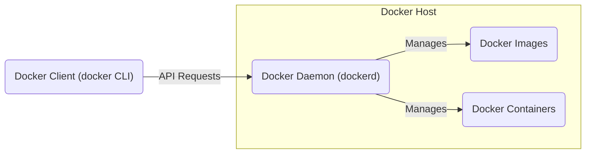
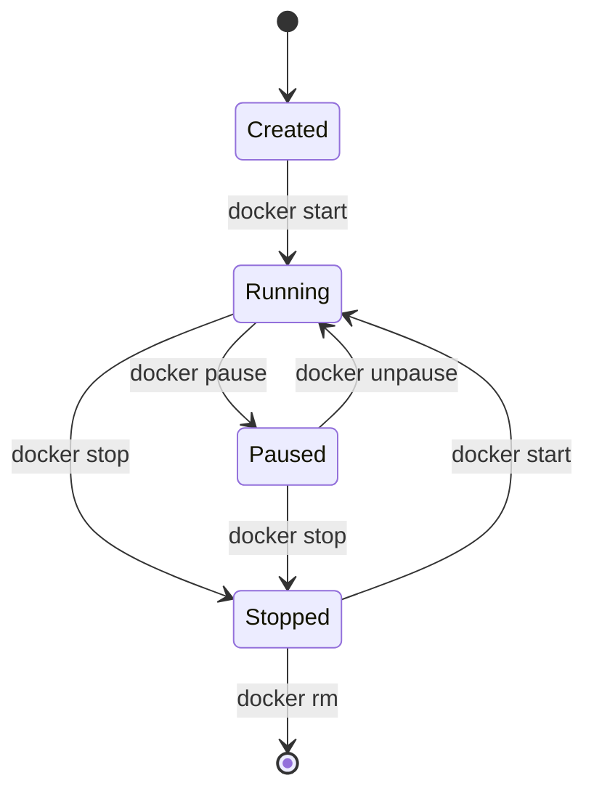

+++
lastmod = "2025-07-03"
date = '2024-12-29T10:09:40-06:00'
draft = false
title = 'What is Docker? A Complete Guide to Containerization'
weight = 1
description = "Learn what Docker is, how it works, and why it's become the industry standard for containerization. This comprehensive guide covers Docker architecture, components, and benefits."
+++



# What is Docker? Understanding Containerization


Docker has revolutionized the way developers build, ship, and run applications. This open-source containerization platform provides a standardized way to package applications with all their dependencies into lightweight, portable containers that can run consistently across different environments.

In this comprehensive guide, we'll explore:
- The fundamental concepts of Docker and containerization
- How Docker differs from traditional virtualization
- The core components of the Docker ecosystem
- Real-world use cases and benefits
- Getting started with basic Docker commands


**Did You Know?** Docker was first released in 2013 and has since become the de facto standard for containerization, with over 13 million developers using Docker as of 2023.


<hr>

## 🏗️ Understanding Docker Architecture

Docker employs a client-server architecture that's both powerful and flexible. This design enables developers to build, ship, and run applications in lightweight, isolated environments called containers. Let's break down the key components and how they interact:


### 🔑 Key Components

#### 1. Docker Daemon (`dockerd`)


- **Purpose**: The persistent background process that manages Docker objects
- **Key Responsibilities**:
  - Building, running, and managing containers
  - Managing images, networks, and volumes
  - Handling API requests from the Docker client
  - Managing container lifecycle

#### 2. Docker Client (`docker` CLI)
```bash
# Example Docker commands
$ docker ps           # List running containers
$ docker build -t myapp .  # Build an image
$ docker run -d -p 80:80 nginx  # Run a container
```

- **Purpose**: The primary way users interact with Docker
- **Key Features**:
  - Command-line interface for sending commands to the Docker daemon
  - Can connect to local or remote Docker daemons
  - Supports all Docker operations (build, run, manage)

#### 3. Docker Images

# Example Dockerfile
FROM node:16-alpine
WORKDIR /app
COPY package*.json ./
RUN npm install
COPY . .
EXPOSE 3000
CMD ["npm", "start"]


- **Purpose**: Blueprint for containers
- **Key Characteristics**:
  - Immutable template with application code and dependencies
  - Built from instructions in a `Dockerfile`
  - Uses Union File System (UFS) for efficient layering
  - Stored in registries (Docker Hub, private registries)

#### 4. Docker Containers
```bash
# Run a container from an image
docker run -d --name myapp -p 8080:80 myapp:latest

# View running containers
docker ps

# Execute a command in a running container
docker exec -it myapp sh
```

- **Purpose**: Runnable instances of Docker images
- **Key Features**:
  - Lightweight and portable
  - Isolated from other containers and the host
  - Ephemeral by design (though data can persist using volumes)
  - Resource-constrained (CPU, memory limits)

#### 5. Docker Registry
```bash
# Pull an image from Docker Hub
docker pull nginx:alpine

# Tag and push to a private registry
docker tag myapp:latest myregistry.com/myapp:1.0
docker push myregistry.com/myapp:1.0
```

- **Purpose**: Storage and distribution system for Docker images
- **Key Features**:
  - Public registries (Docker Hub, GitHub Container Registry)
  - Private registries (self-hosted or cloud-based)
  - Supports image versioning and access control
  - Enables CI/CD pipelines and deployment workflows

### How It All Fits Together

1. **Image Creation**
   - You write a `Dockerfile`
   - Docker builds an image by executing each instruction
   - Each instruction creates a new layer

2. **Container Execution**
   - `docker run` creates a container from an image
   - A thin writable layer is added on top of the image
   - The container runs the specified process

3. **Networking**
   - Each container gets its own network namespace
   - Default networks: bridge, host, none
   - Custom networks enable service discovery

4. **Storage**
   - Containers use copy-on-write (CoW) for efficiency
   - Volumes persist data beyond container lifecycle
   - Bind mounts connect host directories to containers

### Architecture Benefits

- **Isolation**: Containers share the host OS kernel but run in isolated environments
- **Portability**: Same image runs anywhere Docker is installed
- **Efficiency**: Containers share the host kernel and files where possible
- **Scalability**: Easy to start multiple containers from the same image


**Pro Tip:** Use `docker system df` to see disk usage and `docker system prune` to clean up unused objects.


<hr>

## 🔄 How Docker Works: Under the Hood

### The Containerization Process

1. **Image Creation**
   - Developer writes a `Dockerfile` with application requirements
   - Docker builds the image by executing each instruction
   - Each instruction creates an immutable layer in the image

2. **Container Instantiation**
   - `docker run` creates a container from an image
   - A thin writable container layer is added on top of the image
   - The container runs the specified process (e.g., `npm start`)

3. **Resource Management**
   - Docker leverages Linux namespaces for isolation
   - Control groups (cgroups) limit resource usage
   - Union File System (UFS) manages the container's filesystem

### Docker vs. Virtual Machines



#### Docker Containers
- ✓ Share the host OS kernel
- ✓ Start in milliseconds
- ✓ Lightweight (MBs)
- ✓ Less isolation
- ✓ Better performance
- ✓ Lower overhead

---

#### Virtual Machines
- ✓ Run complete OS
- ✓ Start in seconds
- ✓ Heavy (GBs)
- ✓ Strong isolation
- ✓ Higher overhead
- ✓ More resource-intensive



### The Container Lifecycle



### Networking in Docker

Docker provides several networking options:

1. **Bridge**: Default network driver (private internal network)
2. **Host**: Removes network isolation between container and host
3. **Overlay**: Connects multiple Docker daemons (for swarm)
4. **Macvlan**: Assigns a MAC address to containers
5. **None**: Disables all networking

Example of creating a custom bridge network:

```bash
# Create a custom bridge network
docker network create my-network

# Run containers on the custom network
docker run -d --name web --network my-network nginx
docker run -it --network my-network busybox ping web
```

<hr>

## ✨ Benefits of Using Docker

### 1. Consistent Development Environments
- **Problem Solved**: "It works on my machine" syndrome
- **How Docker Helps**:
  - Identical environments from development to production
  - No more "works on my machine" issues
  - Easy onboarding for new team members

### 2. Efficient Resource Utilization
- **Problem Solved**: Wasted resources with VMs
- **How Docker Helps**:
  - Containers share the host OS kernel
  - Lower overhead compared to VMs
  - Higher density of applications per host

### 3. Rapid Deployment and Scaling
- **Problem Solved**: Slow deployment processes
- **How Docker Helps**:
  - Start containers in milliseconds
  - Easy horizontal scaling
  - Simplified CI/CD pipelines

### 4. Version Control and Component Reuse
- **Problem Solved**: Dependency conflicts
- **How Docker Helps**:
  - Version-controlled images
  - Reusable components
  - Easy rollback to previous versions

### 5. Isolation and Security
- **Problem Solved**: Application conflicts
- **How Docker Helps**:
  - Process isolation
  - Resource constraints
  - Reduced attack surface

### Real-World Impact


| Before Docker | With Docker |
|--------------|-------------|
| Hours setting up environments | Minutes to get started |
| "Works on my machine" issues | Consistent across all environments |
| Complex deployment processes | Simple, repeatable deployments |
| Wasted resources | Optimized resource usage |
| Difficult scaling | Easy horizontal scaling |



**Pro Tip**: Use Docker Compose to define and run multi-container applications with a single command. This is especially useful for development environments with multiple services.


<hr>

## ❓ Frequently Asked Questions


Docker containers and virtual machines (VMs) are both virtualization technologies, but they work differently:

| Feature | Docker Containers | Virtual Machines |
|---------|------------------|------------------|
| **OS** | Share host OS kernel | Full guest OS per VM |
| **Size** | MBs (small) | GBs (large) |
| **Startup** | Milliseconds | Seconds to minutes |
| **Performance** | Near-native | Slight overhead |
| **Isolation** | Process-level | Hardware-level |
| **Density** | High (10-100x VMs) | Low |

**Example**: Running 10 applications:
- With VMs: 10 VMs × 1GB each = 10GB+ of disk space
- With Docker: 10 containers sharing base layers ≈ 1-2GB total



Yes, Docker can run on Windows and macOS using Docker Desktop:

- **Windows**:
  - Requires Windows 10/11 Pro, Enterprise, or Education (64-bit)
  - Uses Hyper-V or WSL 2 backend
  - Full Linux container support

- **macOS**:
  - Requires macOS 10.15 or newer
  - Uses a lightweight Linux VM
  - Native Apple Silicon (M1/M2) support

**System Requirements**:
- 64-bit processor with SLAT
- 4GB system RAM (8GB+ recommended)
- Virtualization enabled in BIOS



There are several ways to share Docker images:

1. **Docker Hub** (Public/Private):
   ```bash
   # Login to Docker Hub
   docker login
   
   # Tag your image
   docker tag myapp:latest username/myapp:1.0
   
   # Push to Docker Hub
   docker push username/myapp:1.0
   ```

2. **Private Registry** (Self-hosted or Cloud):
   - AWS ECR
   - Google Container Registry
   - Azure Container Registry
   - Self-hosted (Harbor, Portus)

3. **Save/Load as Archive**:
   ```bash
   # Save image to tar file
   docker save myapp:latest > myapp.tar
   
   # Load image from tar file
   docker load < myapp.tar
   ```



### Common Debugging Commands

**1. View Logs**
```bash
docker logs <container_id>  # View logs
docker logs -f <container_id>  # Follow logs in real-time
docker logs --tail=50 <container_id>  # View last 50 lines
```

**2. Inspect Containers**
```bash
docker ps  # List running containers
docker ps -a  # List all containers
docker inspect <container_id>  # Detailed container info
docker stats  # Live container resource usage
```

**3. Execute Commands**
```bash
# Start an interactive shell
docker exec -it <container_id> sh

# Run a specific command
docker exec <container_id> ls -la /app

# View environment variables
docker exec <container_id> env
```

**4. Network Inspection**
```bash
docker network ls  # List networks
docker network inspect <network_name>  # Network details
docker port <container_id>  # Mapped ports
```



### Docker Security Best Practices

1. **Use Minimal Base Images**
   ```dockerfile
   # Instead of:
   FROM ubuntu:latest
   
   # Prefer:
   FROM alpine:3.15  # or distroless images
   ```

2. **Run as Non-Root User**
   ```dockerfile
   FROM node:16-alpine
   RUN adduser -D appuser && chown -R appuser /app
   USER appuser
   ```

3. **Scan for Vulnerabilities**
   ```bash
   # Scan an image for vulnerabilities
   docker scan nginx:latest
   ```

4. **Limit Resources**
   ```bash
   # Run container with resource limits
   docker run -d --name myapp \
     --memory=512m \
     --cpus=1.5 \
     --pids-limit=100 \
     nginx:alpine
   ```

5. **Use Docker Content Trust**
   ```bash
   # Enable Docker Content Trust
   export DOCKER_CONTENT_TRUST=1
   ```

6. **Regular Updates**
   - Keep Docker Engine updated
   - Rebuild images with updated base images
   - Monitor security advisories


<hr>

## 🚀 Next Steps

Now that you understand what Docker is and how it works, here are some next steps:

1. [Install Docker](/tutorials/docker/installdockerandportainer/) on your machine
2. Try running your first container: `docker run hello-world`
3. Learn how to [write a Dockerfile](/tutorials/docker/dockerfile-best-practices/)
4. Explore [Docker Compose](/tutorials/docker/docker-compose/) for multi-container applications



<hr>

## 📚 Additional Resources

- [Official Docker Documentation](https://docs.docker.com/)
- [Dockerfile Best Practices](https://docs.docker.com/develop/develop-images/dockerfile_best-practices/)
- [Docker Security Best Practices](https://docs.docker.com/engine/security/)
- [Docker Cheat Sheet](https://dockerlabs.collabnix.com/docker/cheatsheet/)
